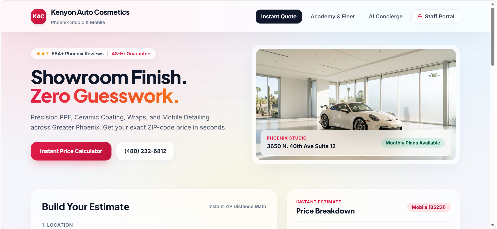
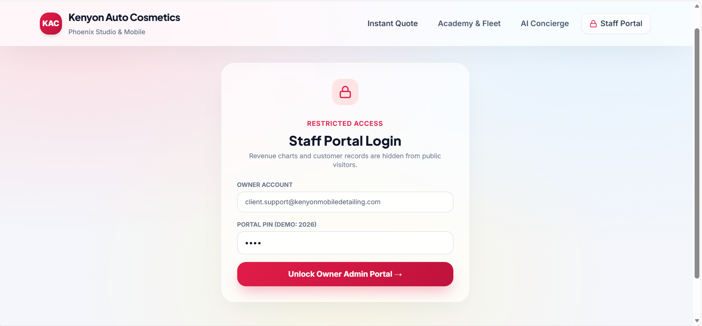
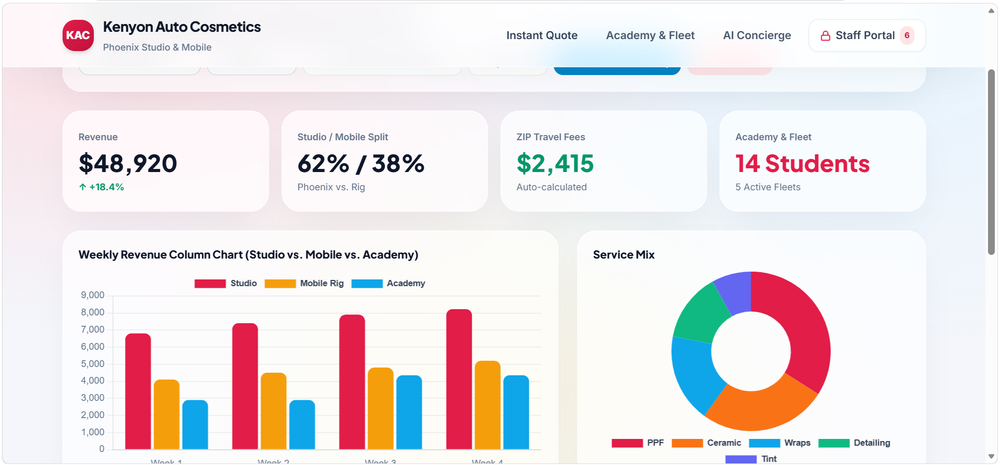
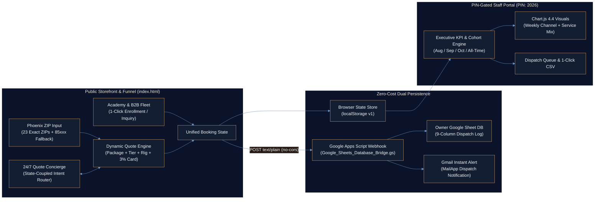

<div align="center">



<br/>

<p align="center">
  <a href="#-interactive-platform-showcase"></a>
  <a href="#-system-architecture--data-flow"></a>
  <a href="#-tech-stack--zero-build-deployment"></a>
  <a href="https://github.com/Ayan-Rajput-Analysis"></a>
</p>

</div>

---

## Executive Summary

> **Governing Mandate:** Eliminate manual mobile detailing quote friction and unrecovered travel costs across Greater Phoenix while unifying retail vehicle bookings, certification academy enrollments, and commercial fleet contracts onto a **`$0/month` client-owned serverless architecture**.

- **Instant Customer Conversion & Zero-Guesswork Pricing:** Replaces a dense 180-word fee policy with a real-time **23-ZIP Greater Phoenix distance engine** (`$59` flat base zone ≤30 miles, automatic `$3/mile` extended radius surcharge across outer cities, `$40` autonomous water/power rig toggle, 4 vehicle size tiers, 6 restyling packages, `+3%` card vs. `0%` cash, and 12-month financing estimates).
- **State-Coupled 24/7 Quote Concierge (`$0` LLM Token Overhead):** Engineered a deterministic client-side intent router that answers natural-language pricing, distance, and Paint Protection Film (PPF) inquiries in milliseconds while **mutating the live calculator state above** for 1-click booking.
- **Multi-Cohort Executive Dispatch & BI Portal:** Consolidates **Phoenix Studio Restyling**, **Mobile Van Dispatch**, **Auto Aesthetics Academy** (`$1,450` & `$890` tracks), and **B2B Fleet Accounts** inside a PIN-gated owner dashboard (`Demo PIN: 2026`) featuring interactive **Chart.js 4.4** revenue & service-mix analytics, 3-month cohort filtering (`$129,250` simulated volume; `$6,535` recovered travel fees), and 1-click CSV export.

---

## Business Problem & Context (SCR Narrative)

- **Situation:** **Kenyon Auto Cosmetics** operates a dual-mode automotive restyling showroom (**3650 N. 40th Ave Suite 12, Phoenix, AZ**) and mobile detailing fleet across the Valley of the Sun (`4.7★` across `584+` local reviews), alongside an in-house **Auto Aesthetics Academy** and commercial fleet program.
- **Complication:** On the legacy site, customers faced a 180-word fine-print paragraph explaining mobile convenience fees, mileage surcharges beyond 30 miles, water/power hookup requirements, and card processing fees—causing quote abandonment and unrecovered mobile dispatch expenses. Meanwhile, standard SaaS booking platforms charged recurring monthly fees and siloed retail, academy, and B2B fleet data.
- **Resolution:** Architected a single-file, zero-build web platform (`index.html`) paired with a 7-line serverless Google Apps Script webhook (`Google_Sheets_Database_Bridge.gs`). Customers compute penny-exact quotes in under 10 seconds, while every booking syncs directly into the business owner's Google Sheet and Gmail inbox at **`$0/month` hosting and database cost**.

---

## Interactive Platform Showcase

<div align="center">
  
  <p><sub><strong>Figure 1:</strong> Light-Glassmorphic Storefront Hero &amp; 3-Step Greater Phoenix ZIP Distance Pricing Engine.</sub></p>
</div>

<table>
  <tr>
    <td width="50%" valign="top">
      
      <p align="center"><sub><strong>Figure 2:</strong> Role-Gated Owner Authentication Screen (<code>Demo PIN: 2026</code>) isolating revenue KPIs and dispatch queues from public visitors.</sub></p>
    </td>
    <td width="50%" valign="top">
      
      <p align="center"><sub><strong>Figure 3:</strong> Unlocked Executive BI Suite with Multi-Month Cohort KPIs, Grouped Weekly Channel Revenue, and Service Mix Telemetry.</sub></p>
    </td>
  </tr>
</table>

<div align="center">
  
  <p><sub><strong>Figure 4:</strong> High-Resolution Studio Bay Brand Asset (PPF, Ceramic Curing &amp; Matte/Gloss Restyling Showcase).</sub></p>
</div>

---

## System Architecture & Data Flow



---

## Core Engineering Capabilities & Pricing Specification

| System Module | Technical Implementation | Quantified Business & Operational Value |
| :--- | :--- | :--- |
| **3-Tier Phoenix Distance Engine** | Exact distance table for `23` Greater Phoenix ZIP codes (`4–54 mi`), regex fallback for `850xx` / `852xx` / `853xx` / `85xxx` Arizona prefixes, and metro default fallback. | Automatically enforces `$59` base travel (`≤30 mi`) plus `$3/mi` extended surcharge (`31–54+ mi`, e.g., Queen Creek `85142` → `+$36` mileage + `$59` base + `$40` rig = `$135` fee). |
| **State-Coupled Quote Concierge** | Deterministic JS intent parser linking natural-language chat queries directly to `state` mutations and `calculateQuote()` re-renders. | Asking *"Queen Creek 85142 fee?"* or *"Color-change PPF?"* answers in `<10ms` at `$0` API cost while pre-configuring the live calculator above. |
| **Multi-Stream Revenue Funnel** | Unified booking schema capturing Retail Restyling (`$149/mo`–`$2,400`), **Auto Aesthetics Academy** (`$1,450` / `$890`), and **Commercial Fleets** (`$3,600`+ multi-van contracts). | Consolidates B2C detailing, vocational training seats, and B2B fleet contracts into a single dispatch queue and revenue ledger. |
| **Executive BI & Cohort Analytics** | PIN-gated (`2026`) view with **Chart.js 4.4** grouped bar & doughnut charts, mode filter (`All / Studio / Mobile`), and month selector (`Aug`, `Sep`, `Oct`, `All-Time`). | Gives ownership instant visibility into Studio vs. Mobile split (`62% / 38%`), recovered travel fees (`$6,535` across 3 cohorts), and CSV export for accounting. |
| **CORS-Safe Serverless Bridge** | `fetch()` `POST` using `Content-Type: text/plain` + `mode: 'no-cors'` paired with `SpreadsheetApp.appendRow()` and `MailApp.sendEmail()`. | Eliminates preflight CORS errors on Google Apps Script endpoints and removes `$29–$99/mo` third-party booking SaaS subscriptions. |

### Deterministic Quote Formula

$$\text{Subtotal} = P_{\text{base}} + V_{\text{size}} + \sum A_{\text{addons}} + \mathbb{I}_{\text{mobile}} \cdot \Big(59 + 3 \cdot \max(0,\, d_{\text{zip}} - 30) + 40 \cdot \mathbb{I}_{\text{no-utilities}}\Big)$$

$$\text{Grand Total} = \text{Subtotal} + \mathbb{I}_{\text{card}} \cdot \operatorname{round}(0.03 \times \text{Subtotal},\, 2), \qquad \text{Monthly Plan Est.} = \max\!\left(19,\, \operatorname{round}\!\left(\frac{\text{Grand Total}}{12}\right)\right)$$

---

## Quality Assurance & Pre-Production Audit

Validated against structured engineering and pre-delivery QA standards:

- **Zero Secrets / Zero Credential Exposure:** Verified `0` hardcoded API keys, `0` live webhook endpoints, and `0` real customer PII records in source control.
- **Demo Sandbox Isolation:** Staff Portal authentication (`PIN: 2026` or `kenyon`) operates strictly over synthetic `Aug–Oct 2026` demonstration cohorts stored in browser `localStorage` (`kenyon_auto_cosmetics_db_v1`) with a 1-click **Reset Saved Demo Bookings** control.
- **Self-Contained Asset Resilience:** Primary storefront hero imagery is base64-encoded directly inside `index.html` alongside defensive `typeof Chart !== 'undefined'` runtime guards, guaranteeing instant rendering from local disk, GitHub Pages, Vercel, or Netlify.
- **UX Remediation Audit Included:** Unlocking the Staff Portal and selecting **View 2 (`Website Fixes — Before/After`)** documents concrete UX, copywriting, and conversion upgrades over the legacy storefront.

---

## Tech Stack & Zero-Build Deployment

<p>
  
  
  
  
  
  
  
</p>

### Repository Structure

```text
kenyon-auto-cosmetics/
├── index.html                           # Zero-build SPA: Storefront, 23-ZIP Quote Engine, Concierge & BI Portal
├── Google_Sheets_Database_Bridge.gs     # Serverless Google Apps Script webhook (Sheets append + Gmail alert)
├── assets/
│   ├── repo-hero.svg                    # Custom Obsidian Navy & Espresso Bronze architectural banner
│   ├── studio-hero-dark.jpg             # Studio bay dark restyling render
│   ├── studio-hero-light.jpg            # Phoenix sunlit showroom render
│   └── screenshots/                     # Verified viewport captures (Storefront, Auth Gate, Executive BI)
└── README.md                            # System architecture, pricing specification & deployment guide
```

### Quickstart (30 Seconds)

1. **Run Locally (Zero Dependencies):**
   ```bash
   git clone https://github.com/Ayan-Rajput-Analysis/kenyon-auto-cosmetics.git
   cd kenyon-auto-cosmetics
   # Open index.html directly in any modern browser, or serve locally:
   npx serve .
   ```
2. **Explore the Executive Staff Portal:** Click **Staff Portal** in the top-right navigation bar and enter Demo PIN **`2026`**.
3. **Optional Live Google Sheets Sync:**
   - Open a new Google Sheet → **Extensions → Apps Script** → paste [`Google_Sheets_Database_Bridge.gs`](./Google_Sheets_Database_Bridge.gs).
   - Click **Deploy → New Deployment → Web App** (*Execute as: Me*, *Who has access: Anyone*).
   - Paste the resulting `https://script.google.com/macros/s/.../exec` URL into the **Google Sheets Webhook** field inside the Staff Portal.

---

<div align="center">
  <sub>Architected &amp; Engineered by <a href="https://github.com/Ayan-Rajput-Analysis"><strong>Ayan Rajput</strong></a> • AI &amp; Deep Learning Engineer | 3D WebGL Specialist | Full-Stack &amp; BI Architect</sub>
</div>
